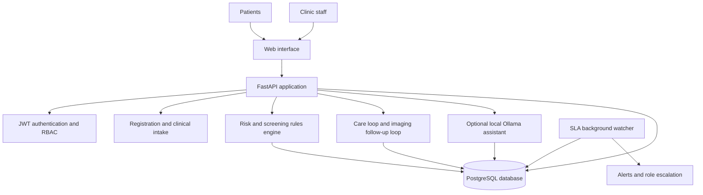
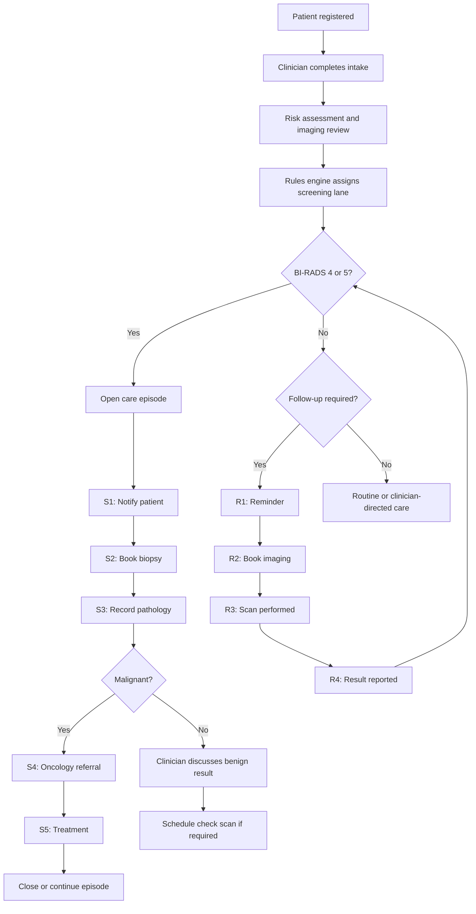

# Screen2Care
## Technical Report

**A screening-to-care coordination platform for breast-screening clinics**  
**Prepared for:** Hackathon Evaluation  
**Version:** 1.0  
**Date:** November 2026

---

## 1. Executive Summary

Screen2Care is a web-based clinical coordination platform designed to reduce the risk of patients being lost between breast-screening, diagnosis, referral, and treatment. The system gives each patient a traceable journey from registration through clinical intake, risk assessment, imaging follow-up, biopsy, pathology, oncology referral, and treatment.

The platform combines a FastAPI backend, PostgreSQL database, server-rendered web interface, role-based access control, automated screening rules, deadline monitoring, patient-facing progress views, and an optional local AI assistant. Its central design idea is to convert an open-ended clinical journey into explicit, role-owned workflow steps with deadlines and escalation paths.

Screen2Care supports two related workflows:

1. **Care loop:** for suspicious BI-RADS 4/5 findings, covering notification, biopsy, pathology, referral, and treatment.
2. **Imaging follow-up loop:** for BI-RADS 0/3, annual, dense-breast, high-risk, and post-benign-biopsy follow-up imaging.

This separation makes responsibilities visible while allowing a new suspicious result to move directly into the urgent care loop. Staff see only the patients and clinical information appropriate to their role, while patients see their own progress and only results that have been formally disclosed by a clinician.

---

## 2. Problem and Proposed Solution

### The problem

Breast-screening care involves multiple departments and time-sensitive handoffs. A patient may be registered by front-desk staff, assessed by a clinician, reported by radiology, biopsied, reviewed by pathology, referred to oncology, and eventually started on treatment. When these activities are tracked through disconnected notes, spreadsheets, messages, or memory, several risks appear:

- abnormal results may not be communicated promptly;
- biopsy or follow-up appointments may not be booked;
- pathology may not be routed to the right team;
- missed deadlines may remain invisible;
- patients may not know what happens next;
- staff may see either too much information or not enough of it.

### The solution

Screen2Care models the process as a set of controlled clinical workflows. Each workflow step has an owner, a status, a deadline, and an auditable event. A rules engine interprets intake and imaging data to assign the appropriate screening lane. The application then creates the corresponding care or follow-up work and routes it to the responsible role.

The system is intentionally designed for human-supervised clinical operations. Automation creates structure, reminders, and escalation; it does not replace clinical judgment. AI-generated notes and call scripts are drafts and require staff review before use.

---

## 3. System Architecture

### Technology stack

| Layer | Technology | Purpose |
|---|---|---|
| Web application | FastAPI, Uvicorn | HTTP API, page routing, lifecycle management |
| Interface | Jinja2, HTML, CSS, JavaScript | Server-rendered role-specific screens |
| Database | PostgreSQL 16 with pgvector image | Persistent clinical, workflow, and audit data |
| Data access | SQLAlchemy, psycopg | Database connectivity and transactions |
| Authentication | bcrypt, JWT cookies | Password verification and session identity |
| Local AI | Ollama | Optional local drafting and staff assistant |
| Operations | Docker Compose, shell scripts | Repeatable local setup and deployment |
| Testing | Pytest | Workflow, access, validation, and SLA tests |

### Block diagram

The application is organized as focused Python modules rather than one large controller. `main.py` exposes pages and API endpoints; `auth.py` and `access.py` enforce identity and visibility; `intake.py`, `risk_engine.py`, and `rules_runner.py` process clinical information; `care_loop.py` and `followup.py` manage workflow state; and `patient_portal.py` prepares the patient-safe view.

---

## 4. End-to-End Patient Journey

### Main flow

### Clinical intake and risk assessment

The intake form captures demographics, symptoms, obstetric and gynecological history, personal and family history, prior breast procedures, clinical breast examination, imaging, and the clinician’s plan. Demographic data entered during registration is read-only during intake. Validation runs in both the browser and server so invalid values cannot be introduced by bypassing the interface.

After saving, the system stores the encounter, imaging records, plan items with due dates, an immutable snapshot of the submitted form, and a calculated risk assessment. The logged-in clinician is recorded as the author; a typed name is not accepted as a substitute for authenticated identity.

The risk engine classifies patients as high, medium, low, or baseline/incomplete. High-risk signals include relevant genetic findings, chest radiation at a young age, certain biopsy findings, and significant family history. Medium-risk signals include dense breasts and BI-RADS 3. The system preserves the assessment for traceability rather than silently overwriting prior clinical history.

### Rules engine and screening lanes

The rules engine applies a defined precedence order. Suspicious BI-RADS 4/5 findings take priority at any age. High-risk criteria are evaluated next, followed by age, BI-RADS, density, and older-patient considerations. Possible outputs include urgent workup, high-risk MRI-only, high-risk DBT plus MRI, routine screening, six-month follow-up, dense-breast follow-up, and wellness hold.

The engine runs after clinical intake, after follow-up results, and on demand for authorized staff. Each assignment is stored with history, allowing the team to understand both the current lane and how the patient reached it.

---

## 5. Workflow, Roles, and Data Protection

### Role-based operations

Screen2Care routes work according to operational responsibility:

- **Admin:** registers patients, assigns clinicians, and approves staff accounts. Front-desk views intentionally exclude clinical results.
- **Clinician:** performs intake, manages plans, discusses results, and starts treatment where appropriate.
- **Navigator:** contacts patients, books biopsies, coordinates referrals, and closes loops.
- **Scheduling Manager:** manages biopsy and imaging bookings.
- **Radiologist:** records imaging and scan results.
- **Pathologist/Lab Director:** records and oversees pathology reporting.
- **Tumor Board:** receives early notification of new suspicious workups and referrals.
- **CMO:** sees cross-clinic oversight, missed deadlines, overdue follow-ups, and loops closed without treatment.
- **Patient:** sees only their own journey, appointments, released notes, and disclosed results.

Access control is enforced at both page and API levels. A user who guesses another patient’s URL still receives an authorization failure. Clinicians are restricted to assigned patients, while operational roles receive worklists appropriate to their function.

### Care loop and disclosure controls

The care loop uses explicit S1–S5 tasks. A later step cannot be completed before its prerequisite is satisfied. Pathology can be recorded before the patient sees the detailed result, but the patient-facing result remains restricted until a clinician records that it was discussed. This distinction supports clinical communication and prevents premature disclosure.

Loops are never deleted. They may be closed with a reason such as lost to follow-up, declined, transferred, or deceased. Authorized leadership can reopen a closed loop, preserving the previous episode as history.

### Database model

The database separates identity, clinical information, workflow state, and audit history. Core entities include:

- `patient`, `staff`, and `app_user` for identity and accounts;
- `encounter`, `clinical_breast_exam`, and `imaging_result` for clinical assessment;
- `patient_risk_profile`, `family_history`, and `prior_breast_procedure` for risk inputs;
- `care_episode`, `biopsy`, `pathology_result`, `referral`, and `treatment` for abnormal-result care;
- `followup_loop`, `followup_task`, and `followup_appointment` for imaging follow-up;
- `sla_definition`, `sla_task`, and `sla_alert` for deadlines and escalation;
- `lane_assignment`, `event_log`, `clinical_note`, and `encounter_snapshot` for decisions, auditability, and history.

The SQL files are applied in sequence, beginning with the base schema and seed data, followed by access, SLA, signup, disclosure, follow-up, booking, and referral extensions. Constraints, indexes, foreign keys, and immutable snapshot triggers protect data consistency.

---

## 6. SLA Monitoring, AI, and Testing

### SLA monitoring and escalation

Each workflow task receives a due time based on the applicable SLA definition. A background watcher periodically checks open tasks. When a deadline is breached, the system creates an alert and routes it to the escalation role. Alerts remain open until the underlying task is resolved, even if a staff member has viewed the alert. This makes the dashboard represent operational completion rather than simple acknowledgement.

The same logic is available through a manual check endpoint for demonstrations and administration. The event log records important transitions, contacts, bookings, pathology, referrals, disclosures, and AI draft creation.

### Local AI assistant

The optional AI feature connects to Ollama running locally. It can draft patient notes, create call scripts for overdue contacts, and answer staff questions about patients available within the user’s access scope. The assistant uses controlled tools for patient lists, alerts, and care-loop retrieval instead of unrestricted database access.

Local execution reduces the need to send clinical data to an external service. AI output is clearly treated as a draft: staff must review it, and the system records that an AI draft was created. If Ollama is unavailable, the core clinical and workflow features remain usable.

### Testing and validation

The project includes tests covering the most important safety and workflow boundaries:

- authentication and login behavior;
- role-based patient access;
- intake validation and duplicate submission protection;
- risk and screening rules;
- care-loop transitions;
- biopsy booking and pathology routing;
- oncology referral behavior;
- result disclosure;
- follow-up loop transitions;
- SLA breach and escalation behavior;
- signup and AI-related behavior.

The testing approach focuses on state transitions and authorization, because those are the areas where a workflow platform can create the greatest operational risk.

---

## 7. Demonstration, Impact, and Future Scope

### Suggested hackathon demonstration

1. Log in as an Admin and register a patient.
2. Log in as a Clinician and complete the intake with a suspicious BI-RADS result.
3. Show the rules engine opening the care episode and the Tumor Board notification.
4. Log in as a Navigator and record patient contact and biopsy booking.
5. Log in as Pathology/Lab Director and record the pathology result.
6. Demonstrate malignant referral or benign-result closure.
7. Show the patient view and the result-disclosure restriction.
8. Trigger or display an SLA alert and show role-based escalation.

### Expected impact

Screen2Care improves visibility, accountability, and continuity across the screening-to-treatment pathway. Its main value is not just storing clinical records; it actively identifies the next required action, the responsible role, and the deadline. This can reduce missed handoffs, improve patient communication, and give clinical leadership a reliable view of unresolved work.

### Limitations and future improvements

The current system is a hackathon prototype and should be clinically validated before production use. Future work could include hospital-information-system integration, real SMS and email notifications, production-grade appointment scheduling, richer risk-model calibration, multi-site deployment, analytics, stronger observability, and formal AI evaluation. Production deployment would also require hardened secrets, HTTPS, backup and recovery procedures, security review, and compliance assessment.

## Conclusion

Screen2Care turns a fragmented breast-screening pathway into a visible, role-aware, deadline-driven care process. Its combination of clinical intake, rules-based routing, separate care and follow-up loops, SLA escalation, patient visibility, audit history, and local AI assistance demonstrates a practical foundation for reducing loss to follow-up while keeping clinical responsibility with healthcare professionals.

---

## Appendix: Quick Technical Reference

**Start locally:** `bash main.sh`  
**Application:** `http://localhost:8000`  
**API documentation:** `http://localhost:8000/docs`  
**Health check:** `http://localhost:8000/health`  
**Database:** PostgreSQL 16 in Docker  
**Primary backend entry point:** `app.main:app`  
**Core workflow modules:** `app/rules_runner.py`, `app/care_loop.py`, `app/followup.py`  
**Test command:** `pytest`
